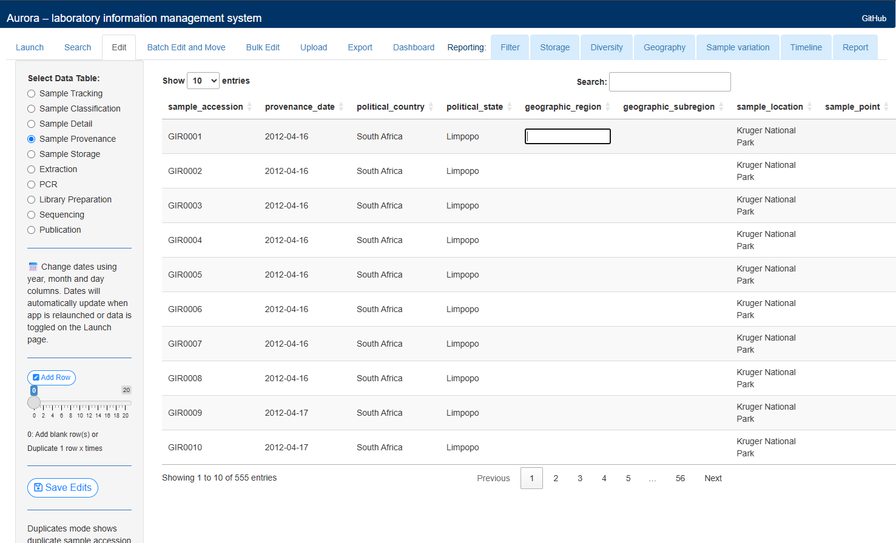
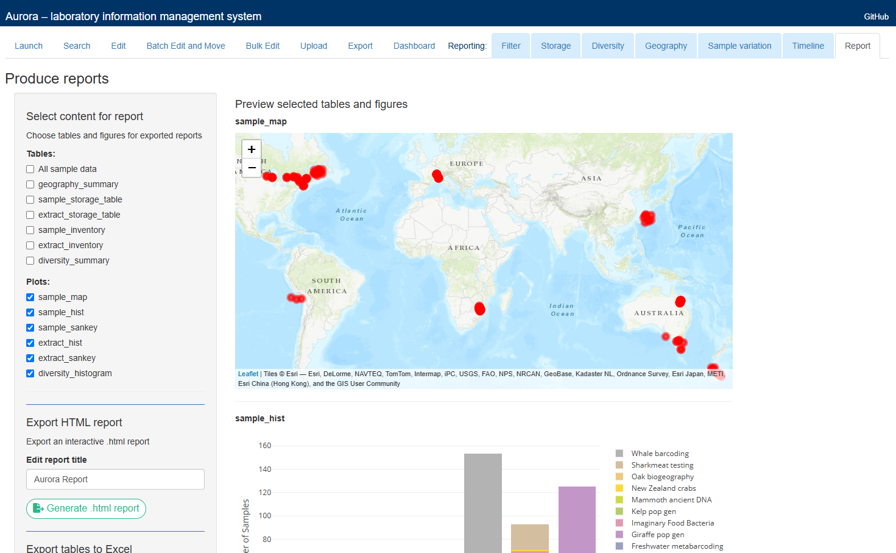
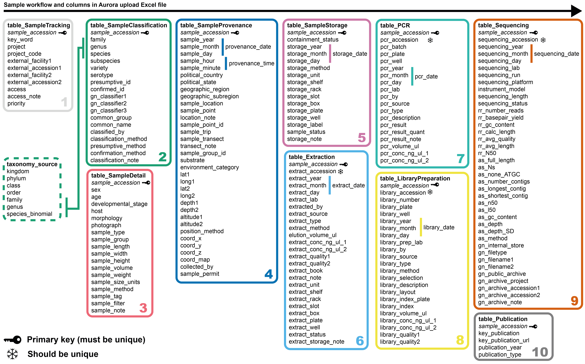
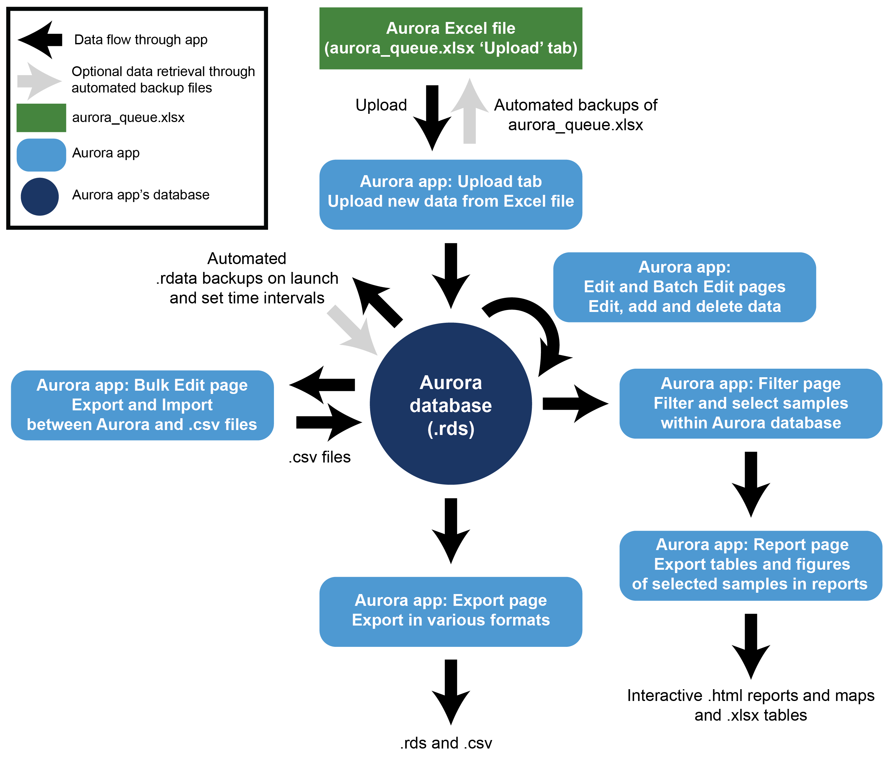

# Aurora
***A free, open-source laboratory information management system for biological samples using R Shiny***

## Contents
- [Summary](#summary)
- [Functionality and features](#functionality-and-features)
- [Installation](#installation)
- [Launch](#launch)
- [Citation and contributors](#citation-and-contributors)
- [AI usage disclosure](#ai-usage-disclosure)

## Summary
`Aurora` is a free, open-source laboratory information management system (LIMS) implemented as an `Shiny` web application using `R` and `RStudio`. Aurora simplifies the management of biological samples and their metadata throughout a laboratory workflow. Aurora is designed to accommodate a wide range of specimen types and it has features tailored for genetic research. Aurora can be used to find specimens, track storage capacity, assess processing times, and it can generate `html` reports with interactive tables, figures and maps to share with colleagues or clients. Aurora is friendly for non-programmers to use, as samples are uploaded via a `Microsoft Excel` spreadsheet, and the application has a simple graphical user interface (GUI) with Excel-like functionality for editing. Aurora automatically checks data formatting and creates regular database back-ups. Users familiar with `R` can readily customise Aurora as it uses a small number of well-annotated `R` scripts and it only relies on a dozen or so common `R` packages. Aurora is needed, as most LIMS are subscription-based, proprietary software that are challenging to customise and existing programs are often unwieldy for the diverse sample types and workflows found in most biological research laboratories.

<p align="center">
  <a href="www/edit-page.png">
  
  </a>
  <a href="www/report-page.png">
  
  </a>
  <em>Screenshots of the Edit and Report pages in Aurora</em>
</p>

## Functionality and features   
Aurora operates as a relational database, where data for each sample is linked to a unique sample accession. Beyond that mandatory identifier field, there are numerous optional fields to record information. These fields are organised and managed across 10 tables. The first five tables record direct sample information: tracking, classification, detail, provenance, and storage. Four tables focus on DNA and RNA research from samples: extraction, PCR, library preparation, and sequencing. A short, final table records information for publications associated with samples, which is mainly relevant for taxonomic research involving type specimens. 

Typically, users begin by entering data into fields using the [aurora_queue.xlsx](Upload/aurora_queue.xlsx) `Excel` file. Aside from the sample accession, all fields are optional and users can arrange (and delete) columns in the `Excel` spreadsheet as they please. The `Excel` file has multiple tabs, so that users can progress samples along a laboratory workflow until they are ready for upload (e.g. sample intake > DNA extraction > PCR > sequencing > pre-upload > upload). That approach is particularly useful when separate personnel hand-over different stages of a laboratory workflow. The `Excel` file includes a data glossary and prompts for most fields, as well as a tab with ~500 rows of example data. When samples are ready to be imported into Aurora, users copy rows to the Upload tab, and we recommend appending those rows to the Manual backup tab as well. 

To launch Aurora, users must have `R`, `Shiny` and `RStudio` installed with the required `R` packages (that can be saved within a user’s `R` library). Aurora uses around a dozen, popular packages. Under `RStudio` settings, Aurora can be opened within an internal window or an external web browser. Aurora needs to be saved in a shared file location to enable multiple users to access the same database files. Local settings (e.g. Excel and OneDrive) may be required to enable simultaneous editing of the [aurora_queue.xlsx](Upload/aurora_queue.xlsx) file. Once installed, users on Windows can launch `Aurora` from a desktop shortcut by following instructions in [`install_desktop_icons.md`](install_desktop_icons.md) using a customised a `.bat` file. 

Once Aurora has been launched from `RStudio`, users import samples from [aurora_queue.xlsx](Upload/aurora_queue.xlsx) using the Upload page. Aurora automatically creates back-ups of the database and the `Excel` file, and it checks formatting and provides warnings if there are any issues. Alternatively, samples can be added manually using buttons and Excel-like functionality on the Edit page.

All data is saved locally within the Aurora application’s folders, and Aurora does not connect with the internet or any external databases. Permanent RDS files store all data as characters, and when launched, Aurora loads data into memory and transforms certain fields into appropriate formats (e.g. numeric). 

Users can edit data in Aurora using the Edit page. That page includes functions to identify and remove potential duplicate entries. The Batch Edit and Move page can be used to rename or move storage containers across many samples or extractions. The Bulk Edit page can be used to export and re-import an entire table for editing outside of Aurora. Users can edit different tables within the database at the same time (e.g. Sample Detail and Sample Storage). However, simultaneous edits or bulk imports involving the same table may create editing conflicts. To reduce the risk of overwriting changes made by another user, Aurora checks whether a data file has been modified since it was loaded before saving (using the 'safesave' function).

Users can explore the database and search for samples or groups using the Search page. The Dashboard provides tables and interactive figures that track database size and sample accumulation over time, which can be used to assess database integrity (e.g. checking whether the correct number of samples have been added after an upload). A toggle on the Launch page allows users to switch to the example dataset.

The entire database can be exported in RDS and .csv formats on the Export page. Aurora can be used to generate lists and reports for any set of samples. On the Filter page, users select samples and the subsequent Storage, Diversity, Geography, and Timeline provide interactive tables and figures for those samples. The Report page enables users to export those tables and figures within an interactive `html` file, and tables can also be exported as `Excel` files. These reporting features are designed for practical laboratory management, such as printing lists of freezer contents during an audit or defrost, sharing sequencing progress for a particular project, or mapping the location of samples belonging to a particular genus.

To avoid repetitive data entry and editing, high-level taxonomic information (e.g. kingdom, phylum) is managed in another `Excel` file, [taxonomy_source.xlsx](Taxonomy/taxonomy_source.xlsx). Users can manually edit that reference table to update taxonomic information for samples. If desired, we have provided a utility `R` code to retrieve information from the Global Biodiversity Information Facility (GBIF).

We encourage users familiar with `R` to customise Aurora. All of the `R` scripts are well-annotated and the Launch page answers frequently asked questions. Adding new columns or tables only requires a few changes that are flagged in annotations.

<p align="center">
  <a href="www/AuroraEntityRelationships.png">
  
  </a>
  <br>
  <em>An entity relationship diagram illustrating the ten tables within the Aurora database structure</em>
</p>

<p align="center">
  <a href="www//AuroraDataFlow.png">
  
  </a>
  <br>
  <em>An illustration showing how data flows in and out of Aurora for upload, editing, export and reporting</em>
</p>

## Installation
1. Install [R](https://cran.r-project.org/) and [RStudio](https://posit.co/download/rstudio-desktop/).

2. Download this repository from GitHub (**Code → Download ZIP**), or clone it using the following command in R (requires Git to be installed):
   
   ```r
   system("git clone https://github.com/fvaux/aurora.git")
   ```

   For multi-user access, save the Aurora folder in a shared file location.

4. Open the Aurora R project (`Aurora.Rproj`) in RStudio. Open [`global.R`](global.R) and install the required R packages listed at the top of the file.

**Optional (Windows):** Users can create a desktop shortcut to launch Aurora by following the instructions in [`install_desktop_icons.md`](install_desktop_icons.md), using a customised `.bat` file.

## Launch

1. Open the Aurora R project (`Aurora.Rproj`) in RStudio.
2. Open `app.R`.
3. Click **Run App**. To launch Aurora in an external web browser, click the dropdown arrow beside **Run App** and select **Run External**.

**Alternative (Windows):** Users who have configured a desktop shortcut using [`install_desktop_icons.md`](install_desktop_icons.md) can launch Aurora directly from their desktop.

## Citation and contributors
Aurora was developed by Grant Abernethy and Felix Zareie-Vaux.

**Please cite:**
Zareie-Vaux, F., & Abernethy, G. A. (2026). Aurora: a free, open-source laboratory information management system for biological samples using R Shiny. *Journal of Open Source Software*, XX, XX–XX. [DOI](https://www.doi.org/).

**GitHub repository:** [https://github.com/fvaux/aurora](https://github.com/fvaux/aurora)

## AI usage disclosure
Generative artificial intelligence chatbots, Google Gemini 3 Flash and OpenAI ChatGPT-5.3, assisted with R code generation, editing and annotation. All authors have reviewed, edited and validated these AI-assisted outputs and made the core design decisions.
